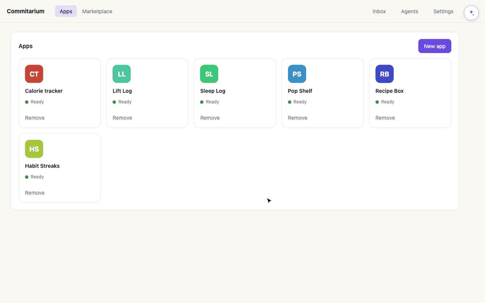

# Commitarium

**You describe it. Commitarium builds it.**

[](https://github.com/EinarLogiOskars/commitarium/actions/workflows/ci.yml)
[](https://github.com/EinarLogiOskars/commitarium/releases)
[](LICENSE)



<sub>*Sped up. In reality, an app like this takes about half an hour to build,
and a small change a few minutes.*</sub>

Want an app that does exactly what you need? Tell Commitarium in a sentence.
Its assistant plans the app, hands the work to coding agents, checks what they
make, and opens the finished app on your computer. Want it different? Ask, and
it changes.

- **No coding needed.** You talk to one assistant in plain words. It takes care
  of the plan, the code, the setup, and the fixes when something breaks.
- **Yours, on your computer.** Your apps and their data stay on your machine.
- **Uses the AI you already have.** Sign in with your Claude or Codex account.
  Commitarium keeps an eye on your usage limits and spreads the work to fit.
- **Checked, not just generated.** A second agent, ideally from another
  provider, reviews every plan and every change before it lands.

**[Download for macOS, Windows, or Linux](https://github.com/EinarLogiOskars/commitarium/releases)**
· needs [Docker](#requirements) and a Claude or Codex account.

> [!IMPORTANT]
> Commitarium is pre-1.0 early-access software. The core is in daily use and
> tested, but expect rough edges. Use it on repositories you can recover.

## What it does

Behind the apps, Commitarium is a full software workshop for developers too: a
lead agent builds, a reviewer from a different provider checks the plan and the
code, every change goes through a pull request, and you decide how much the
assistant may do on its own. Everything runs on your machine, in Docker, with
a private Forgejo instance keeping the history.

- **Apps from a sentence.** The Apps area is where Commitarium opens. **New
  app** turns a description into a project with a written plan, a chosen
  stack, and work under way. A finished app opens in its own window.
- **One assistant.** It writes the project's vision, breaks it into work
  orders, picks agents and models for each, and starts them. Every project has
  one of two modes:
  - **Assists me** (the default): the assistant proposes and you approve. Your
    own work orders stay yours.
  - **Builds everything for me**: the assistant owns the project end to end.
    It writes the vision, sets up the stack and the preview, and creates,
    starts, and finishes the work, including drafts you add. Apps made through
    New app start in this mode.
- **Autopilot that recovers.** Interrupted turns retry on their own, approved
  work is brought up to date with main before it merges, and a failure pauses
  a work order instead of ending it. When the assistant can't fix something,
  it tells you in plain words with one thing to do.
- **Independent review.** Lead and reviewer run as separate sessions, ideally
  on different providers, so no model signs off on its own work.
- **Work that fits the task.** A work order can run in full (clarify, plan,
  implement, review), planned, or as a quick change. Sessions let you steer an
  agent turn by turn for small edits.
- **Agents you add.** Sign in to Codex or Claude accounts on the Agents page.
  Commitarium shows each account's usage limits and keeps the CLIs up to date;
  the assistant spreads work by what is left.
- **Verified previews.** Commitarium runs the app's setup before calling it
  ready. If the app doesn't start, the lead gets the evidence and up to three
  tries to fix it.
- **Packages you approve.** Agents ask for the system packages they need; you
  approve or decline them, and the workers' images are rebuilt to include
  them.
- **Marketplace (early).** Release an app to a shared marketplace and install
  other people's apps as your own copy.
- **Developer mode.** Shows the projects, the work order pages, the Forgejo
  history, and the system's status. Without it, Commitarium is just the apps.

## How a change happens

```text
You ask (or the assistant proposes)
       ↓
The assistant writes it up as a work order and picks the agents
       ↓
Lead plans ↔ reviewer challenges the plan
       ↓
Lead implements → reviewer checks the code → corrections
       ↓
Brought up to date with main, then merged (by you or by policy)
       ↓
The app's preview updates; developers can sync the result to their own repository
```

Every step is recorded and survives restarts. How many of these steps need
your approval depends on the project's mode and merge policy.

## Install

### Requirements

- Docker Desktop with Docker Compose on macOS or Windows
- Docker Engine with the Compose v2 plugin on Linux
- A Codex or Claude account (both work best: lead and reviewer then come
  from different providers)
- Git on the host. On macOS, the first use prompts you to install Apple's
  Command Line Tools

Supported operating-system and Docker versions are listed in
[the support matrix](docs/support-matrix.md).

### Download

Download the latest release from
[GitHub Releases](https://github.com/EinarLogiOskars/commitarium/releases):

| Platform | Download | Architecture |
| --- | --- | --- |
| macOS | `.dmg` | Universal: Apple Silicon and Intel |
| Windows | NSIS `.exe` | x86-64 |
| Linux | `.AppImage` | x86-64 |

Start Docker, then open Commitarium. On launch, the app:

1. checks that Docker and Compose are available;
2. explains what to install or start when they are unavailable;
3. pulls the matching versioned service images from GHCR;
4. initializes the private local services and credentials;
5. waits for the core stack to become healthy; and
6. opens on Apps.

Service images are available for both `linux/amd64` and `linux/arm64`. Apple
Silicon therefore runs native ARM containers rather than emulating Intel
containers.

### Unsigned installers

Commitarium is a personal, source-available project. Its installers are not
code-signed, and paying for signing certificates to remove a first-launch
prompt on binaries anyone can rebuild is out of scope. The macOS build is
ad-hoc signed but not notarized; the Windows installer is unsigned.

You approve the app once, per machine:

- **macOS.** Gatekeeper blocks the first launch. Right-click the app and choose
  **Open**, or run `xattr -dr com.apple.quarantine /Applications/Commitarium.app`
  once. It launches normally afterwards.
- **Windows.** SmartScreen shows an "unknown publisher" warning. Choose **More
  info → Run anyway**.
- **Linux.** Nothing to approve.

If you would rather not trust a prebuilt binary at all, [build from
source](#run-from-source) — the whole project compiles locally.

To report a security problem, see [the security policy](SECURITY.md).

## Getting started

1. Open **Agents** and add an agent: give it a name, choose Codex or Claude,
   and sign in. Add a second one from the other provider if you can.
2. In **Apps**, choose **New app** and describe what you want. The assistant
   takes it from there and opens the app when it is ready.
3. To work on an existing repository instead, turn on **Developer mode** in
   Settings, import a clean Git repository under **Projects**, and talk to the
   project's assistant or create a work order yourself.

Agents iterate in Commitarium's internal Forgejo. Your own repository receives
an accepted result only through the explicit sync, and pushing it to GitHub,
GitLab, or another remote is a separate step.

## Architecture

```text
┌────────────────────────────────────────────────────────────┐
│ Native desktop app (Tauri + React)                         │
│ Docker lifecycle · agent login · previews · CLI updates    │
└───────────────────────────┬────────────────────────────────┘
                            │ narrow local APIs
┌───────────────────────────▼────────────────────────────────┐
│ Docker Compose                                             │
│                                                            │
│  ┌─────────────┐     ┌───────────┐     ┌─────────────────┐ │
│  │ Coordinator │────▶│  Forgejo  │◀────│ Agent workers   │ │
│  │ Go + SQLite │     │ local Git │     │ Codex / Claude  │ │
│  └─────────────┘     └───────────┘     └─────────────────┘ │
└────────────────────────────────────────────────────────────┘
```

The Go coordinator owns the workflow state machine, the assistant, autopilot,
and restart recovery. Forgejo is the durable collaboration record. Provider workers supervise exact
CLI sessions and expose a narrow authenticated API to the coordinator. The
Tauri backend is the trusted boundary for Docker, agent sign-in, running
previews, and explicit host-side Git operations.

See the [1.0 vision](V1_VISION.md), the [product and architecture
plan](docs/plans/PROJECT_PLAN.md), and the [architecture decision
records](docs/adr) for the reasoning behind these boundaries.

## Security and data boundaries

Commitarium is local-first, not an offline AI system. Its coordinator,
database, Forgejo instance, credentials, and managed workspaces live locally.
When you choose a real provider, that provider's CLI may send prompts and
relevant repository context to the provider under your account and its terms.

Provider workers receive only their own login profile, internal Forgejo
identity, and managed workspace access. They do not receive your upstream Git
credentials or the host Docker socket. Host-side repository synchronization
and upstream publication remain separate, explicit actions.

## Run from source

### Prerequisites

- Go 1.27.1 or newer
- Node.js 24 and pnpm 10
- Stable Rust with the platform prerequisites required by Tauri 2
- Docker with Compose v2

Clone the repository, install the frontend dependencies, and start the desktop
development build:

```sh
git clone https://github.com/EinarLogiOskars/commitarium.git
cd commitarium/desktop
pnpm install --frozen-lockfile
pnpm tauri dev
```

Development builds use [`compose.yml`](compose.yml) directly and build service
images from the local Dockerfiles. The desktop runs the coordinator with the
real Codex/Claude workflow; set `COMMITARIUM_RUNNER_MODE=simulated` in the
environment that launches it for the deterministic simulation, which is also
the default for the stack started without the desktop. Installed releases
combine that file with [`compose.release.yml`](compose.release.yml), enable the
real Codex/Claude workflow, pull versioned GHCR images, and disable local
builds.

To work on the stack without the desktop UI, first run the desktop app once so
it can create the private local credentials, then run from the repository root:

```sh
docker compose up --build -d
curl http://127.0.0.1:8080/health
```

## Development checks

Run the core checks locally:

```sh
test -z "$(gofmt -l .)"
go test ./...
go test -race ./...
go vet ./...

cd desktop
pnpm lint
pnpm format:check
pnpm build
cargo fmt --all --manifest-path src-tauri/Cargo.toml -- --check
cargo clippy --all-targets --locked --manifest-path src-tauri/Cargo.toml -- -D warnings
cargo test --locked --manifest-path src-tauri/Cargo.toml
```

Additional container recovery and real-provider smoke tests live in
[`scripts/`](scripts). GitHub Actions runs version validation, Compose release
rendering, Go formatting, vet and tests, frontend linting, formatting and build,
and Rust formatting, Clippy and tests for every pull request and push to `main`.

## Documentation

| Document | Purpose |
| --- | --- |
| [1.0 vision](V1_VISION.md) | Where Commitarium is going: assistant, work orders, sessions, apps |
| [Product and architecture plan](docs/plans/PROJECT_PLAN.md) | Product principles, scope, and the foundation's system design |
| [Apps](docs/plans/APPS_PLAN.md) · [Assistant](docs/plans/ASSISTANT_PLAN.md) · [Previews](docs/plans/PREVIEW_PLAN.md) · [Marketplace](docs/plans/MARKETPLACE_PLAN.md) | Plans for the main areas |
| [Security policy](SECURITY.md) | Supported versions, reporting, and what counts as a vulnerability |
| [Support matrix](docs/support-matrix.md) | Supported host operating systems, Docker, and Compose |
| [Threat model](docs/threat-model.md) | Trust assumptions, protected assets, and boundaries |
| [Backup and restore verification](docs/backup-restore-verification.md) | Manual end-to-end procedure run before a stable release |
| [Release guide](docs/releasing.md) | Versioning, image publication, installers, and release verification |
| [Desktop IPC](docs/desktop-ipc.md) | Trusted Tauri command and event contract |
| [Coordinator API](docs/coordinator-api.md) | Coordinator HTTP API and event stream |
| [Final-message streaming](docs/final-message-streaming.md) | Transient final-response previews and frontend handoff |
| [Worker API](docs/worker-api.md) | Authenticated worker protocol |
| [UI/backend status](docs/ui-backend-status.md) | Current integration status and ownership boundaries |
| [Architecture decisions](docs/adr) | Accepted architectural decisions and rationale |

## Release model

A `v*` Git tag starts two release workflows:

- multi-platform service images are published to GHCR with version and commit
  tags, provenance, and an SBOM;
- native macOS, Windows, and Linux packages plus signed update artifacts are
  attached to a draft GitHub release for final clean-machine verification.

The desktop version and service-image version are intentionally locked
together. See [the release guide](docs/releasing.md) before creating a tag.

## Contributing

Issues and focused pull requests are welcome. For substantial behavioral or
architectural changes, open an issue first so the proposed direction can be
discussed. Please include tests for changed behavior and keep privileged host
operations narrow and explicit. See the [contributor guide](CONTRIBUTING.md) for
repository conventions, required checks, documentation rules, and security
boundaries.

## License

Commitarium is available under the [Apache License 2.0](LICENSE).
